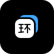
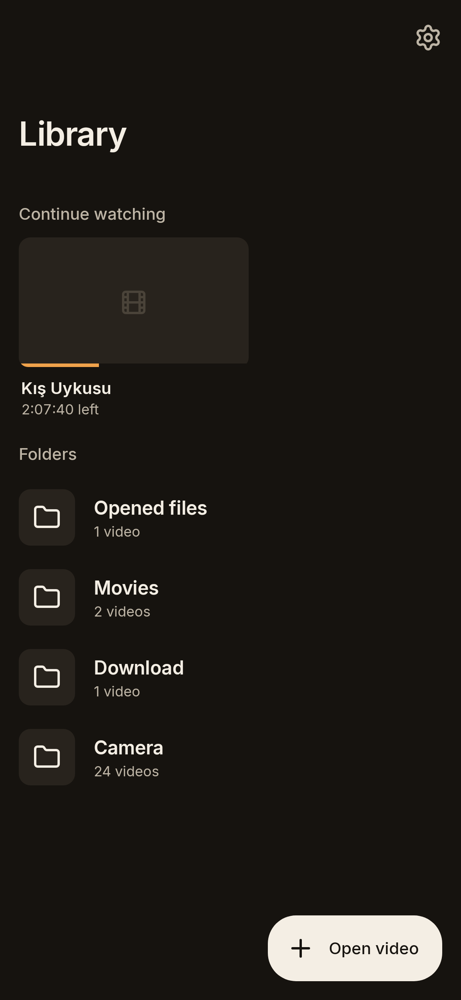
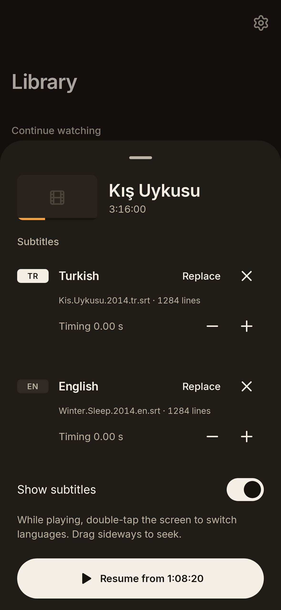
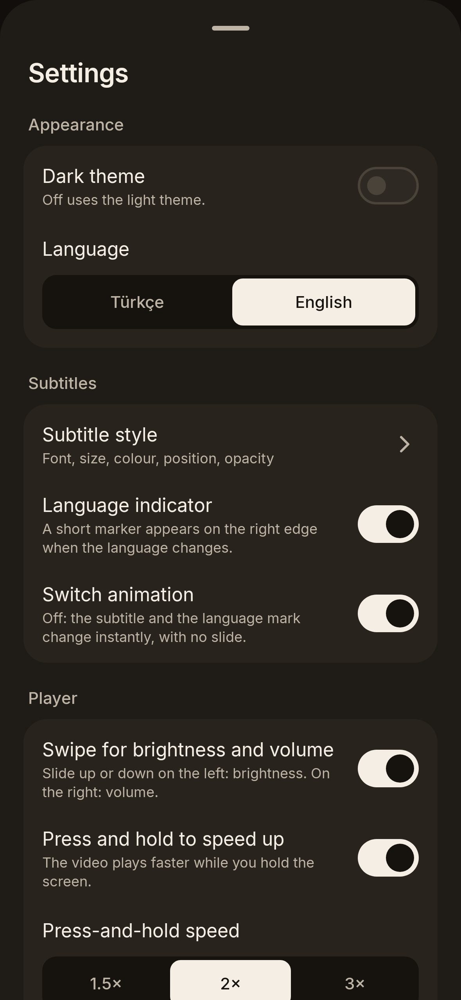
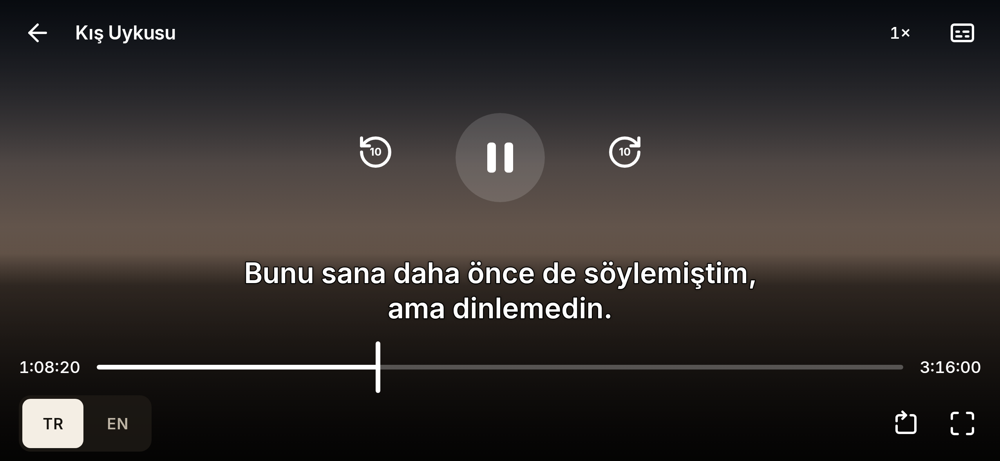

<div align="center">
  

  # Looplayer

  **Watch in two languages. Switch with one double-tap.**

  [](app/build.gradle.kts)
  [](gradle/libs.versions.toml)
  [](PRODUCT.md)
  [](gradle/libs.versions.toml)

  [Features](#features) · [Gestures](#gestures) · [Build](#build-and-run) · [Tests](#tests) · [Project structure](#project-structure) · [Design](#design)
</div>

Looplayer is a local video player for Android with one job it does better than the rest: loading **two subtitle files** (for example Turkish and English) and **swapping between them instantly**, without pausing the video or opening a menu. Double-tap the picture and the subtitle language changes in place.

<div align="center">
  
  &nbsp;
  
  &nbsp;
  
  <br><br>
  
</div>

## Features

- 🈯 **Two subtitle slots.** Primary and secondary languages are a first-class concept, not a buried track menu. SRT, WebVTT and SSA/ASS are supported.
- 👆 **One-gesture language switch.** Double-tap anywhere on the picture. A short marker on the right edge confirms the active language.
- 🎞️ **Subtitles from everywhere.** Pick files, let Looplayer find matching files next to the video, or extract a text track embedded in the video and assign it to slot 1 or 2.
- ⏱️ **Timing offset.** Nudge a subtitle earlier or later per slot when a file is out of sync.
- 🎨 **Subtitle styling.** Font, size, weight, colour, opacity, backdrop (outline, shadow or box) and height.
- 📚 **Library.** Continue-watching row with progress, device videos browsed folder by folder, resume position per file.
- ▶️ **Full player.** Seek bar, ±10 s skip, previous/next subtitle line, playback speed, press-and-hold speed boost, A–B repeat, audio track choice, sleep timer, touch lock, fit/fill, picture-in-picture.
- 🔄 **Rotation.** Orientation follows the video or the phone, with a rotation lock.
- 🌍 **Turkish and English UI**, dark and light themes, and a bundled Inter typeface.
- ♿ **Accessible by default.** Every gesture has a visible control with a content description, touch targets are at least 48 dp, and subtitles respect font scale.

## Gestures

| Gesture | Action |
| --- | --- |
| Double-tap | Switch subtitle language |
| Single tap | Show or hide controls |
| Horizontal drag | Scrub backward or forward |
| Vertical drag, left side | Brightness (optional) |
| Vertical drag, right side | Volume (optional) |
| Press and hold | Temporary speed boost (optional) |

The language switch is also available as a button in the control bar.

## Build and run

Requirements: JDK 17 and the Android SDK (API 36). Gradle and the Android Gradle Plugin are fetched by the wrapper.

```bash
./gradlew :app:assembleDebug
```

The APK is written to `app/build/outputs/apk/debug/`. To install on a connected device or emulator:

```bash
./gradlew :app:installDebug
```

A minified release build is available through `:app:assembleRelease`; configure your own signing before distributing it.

| | |
| --- | --- |
| Application ID | `app.looplayer` |
| Version | `1.0` (code 1) |
| minSdk / targetSdk | 26 / 36 |
| ABIs | `arm64-v8a`, `armeabi-v7a` |

## Tests

```bash
./gradlew test
```

The suite runs on the JVM with Robolectric:

- **Unit tests** for subtitle parsing, the subtitle session, settings, sibling-file discovery, embedded tracks and device video listing.
- **Gesture and playback tests** that push real H.264 through ExoPlayer and exercise double-tap switching and drag seeking on the full player screen.
- **Screenshot tests** (Roborazzi) that render the real composables on phone and tablet, at default and 130 % font scale. The images in [`app/src/test/screenshots`](app/src/test/screenshots) are the ones shown above.

## Project structure

```text
looplayer/
├── app/                              # Android application
│   └── src/main/java/app/looplayer/
│       ├── data/                     # library, settings, subtitle session, sibling and embedded subtitles
│       └── ui/
│           ├── library/              # library and setup sheet
│           ├── player/               # player screen, gestures, more sheet
│           ├── settings/             # settings and subtitle style sheets
│           ├── components/           # language tabs, subtitle slots
│           └── theme/                # palette, icons, subtitle style
├── subtitle-core/                    # pure Kotlin subtitle parser (SRT, VTT, SSA/ASS)
├── PRODUCT.md                        # users, purpose, principles
├── DESIGN.md                         # design system
└── gradle/libs.versions.toml         # dependency versions
```

## Design

The product intent and the visual system are written down so changes stay consistent:

- [`PRODUCT.md`](PRODUCT.md): who it is for, what it does, and the principles (the picture is the product; language switching costs one gesture; gestures always have visible controls; respect the system).
- [`DESIGN.md`](DESIGN.md): the true-black, flat design system.

## Permissions

| Permission | Why |
| --- | --- |
| `READ_MEDIA_VIDEO` (and `READ_EXTERNAL_STORAGE` up to Android 12L) | Browse and play videos on the device |
| `MANAGE_EXTERNAL_STORAGE` | Optional: pick up subtitle files sitting next to a video |
| `INTERNET`, `ACCESS_NETWORK_STATE` | Open video links passed in by other apps |

There are no accounts and no analytics.

## Third-party licenses

Looplayer bundles Inter, Atkinson Hyperlegible Next, Inconsolata, Open Sans, PT Sans Narrow and Roboto (SIL Open Font License) and Lucide icons (ISC). The license texts are in [`app/src/main/assets/licenses`](app/src/main/assets/licenses).
